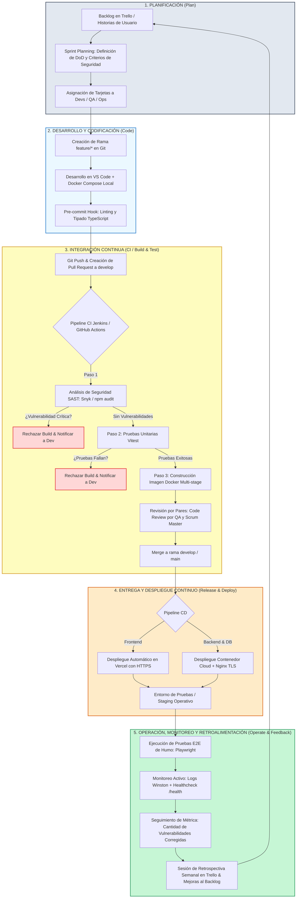

# Práctica Momento 1: Planificación DevOps en Proyecto de Desarrollo de Software
## Gestión Web Segura para Cafetería Orgánica y Comercial ("Monchis Café")

**Institución:** Universidad de Guadalajara — Centro Universitario de Tonalá (CUTonalá)  
**División:** División de Ingenierías e Innovación Tecnológica  
**Programa Académico:** Licenciatura en Ingeniería en Computación  
**Materia:** Productos Integradores / Proyecto Integrador de Desarrollo de Software  
**Docente:** Dr. Gabriel Navarro Salcedo  
**Equipo Asignado:** Equipo 2  
**Fecha de Entrega:** 3 de noviembre de 2026  

---

### Integrantes del Equipo y Roles DevOps
1. **Ernesto Hatuey Fierro Medina** (Código: 215487963) — *Scrum Master & DevOps Lead (Ops)*
2. **Jazmín Díaz** — *Frontend Core Developer (Dev)*
3. **Héctor Hernández** — *Backend & Data Core Developer (Dev)*
4. **Oswaldo Millán** — *QA, Test Automation & Security Engineer (QA)*

---

## 1. Definición del Proyecto y su ODS Asociado

### 1.1 Nombre y Problemática del Negocio
El proyecto asignado al Equipo 2 corresponde a la **Gestión Web Segura para Cafetería Orgánica y Comercial**, implementado bajo la solución integral denominada **"Monchis Café"**.

**Contexto y Problemática:**
Las cafeterías de especialidad que comercializan tanto café orgánico regional (grano de sombra de pequeños productores) como insumos comerciales complementarios enfrentan tres retos operativos críticos:
1. **Carencia de Trazabilidad y Desperdicio de Insumos Orgánicos:** Ausencia de registro digital sobre el origen del café (finca, altitud, cooperativa de procedencia, fecha de tostado) y falta de un control de inventarios basado en la política PEPS (Primeras Entradas, Primeras Salidas), ocasionando mermas de productos perecederos de alto valor.
2. **Vulnerabilidades en Seguridad Web y Control de Acceso:** Los sistemas de cobro tradicionales suelen manejar contraseñas inseguras, sesiones estáticas no revocables, falta de segregación de roles entre cajeros y administradores, y ausencia de defensas contra ataques web comunes (inyecciones SQL, Cross-Site Scripting, bots de fuerza bruta), comprometiendo los fondos de caja y la privacidad de los clientes.
3. **Desconexión con Prácticas Sustentables y Fidelización:** Ausencia de un canal digital que premie a los consumidores conscientes que reducen los residuos de un solo uso (vasos desechables) y falta de integración con programas modernos de fidelización.

### 1.2 Alcance y Solución Propuesta
La solución consiste en una plataforma web integral, modular y de alta seguridad, estructurada en un monorepo profesional:
- **Punto de Venta Táctil (POS) y Catálogo Web:** Interfaz reactiva optimizada para tabletas y navegadores web (Vue 3 + Vite), con navegación diferenciada y adaptada a la velocidad del mostrador.
- **Autenticación Stateless y Seguridad Robusta:** JSON Web Tokens (JWT) rotativos con Refresh Tokens resguardados en cookies `httpOnly`, `Secure` y `SameSite=Strict`; Control de Acceso Basado en Roles (RBAC: `admin`, `cajero`, `cliente`), doble factor de autenticación (2FA) para el administrador y Google reCAPTCHA v2/v3 para mitigar bots.
- **Trazabilidad de Café de Especialidad:** Registro estructurado por lote, cooperativa productora, altitud y tostado, con alertas automáticas de caducidad.
- **Transacciones Distribuidas Seguras:** Orquestación asíncrona mediante broker RabbitMQ con patrón Saga para reversas compensatorias automáticas (si se cobra una orden pero se agotan los insumos en inventario, se revierte el cobro y se cancela la orden sin descuadrar la caja).
- **Programa "Monchis Rewards":** Monedero electrónico, sellos digitales y bonificación ecológica.

### 1.3 Objetivos de Desarrollo Sostenible (ODS) Asociados

#### A. ODS Principal: ODS 12 — Producción y Consumo Responsables
El núcleo funcional y operativo de Monchis Café se alinea directamente con las metas del **ODS 12 de la Agenda 2030 de las Naciones Unidas**:
- **Meta 12.2 (Gestión sostenible y uso eficiente de los recursos naturales):** El sistema prioriza y visibiliza el catálogo de café orgánico cultivado bajo sombra y de comercio justo proveniente de cooperativas mexicanas (Michoacán, Chiapas y Oaxaca), reduciendo la huella de carbono asociada al transporte masivo y fomentando métodos agrícolas sin agroquímicos dañinos.
- **Meta 12.5 (Reducción considerable de la generación de desechos mediante prevención, reducción y reutilización):** El software incorpora de forma nativa la **"Bonificación Ecológica"**: al registrar una venta en el POS donde el cliente utiliza su propia taza o termo reutilizable, el sistema aplica automáticamente un descuento directo de $5.00 MXN y otorga sellos dobles en el monedero digital "Monchis Rewards". Esta funcionalidad elimina sistemáticamente el consumo de miles de vasos y tapas de plástico y polipapel desechables al mes.
- **Meta 12.3 (Reducción de pérdidas y desperdicios de alimentos):** Mediante el control de inventarios PEPS automatizado y alertas preventivas de caducidad vía SMTP, se minimiza el desperdicio de insumos orgánicos perecederos y productos de repostería artesanal.

#### B. ODS Transversales Complementarios
- **ODS 8: Trabajo Decente y Crecimiento Económico (Metas 8.2 y 8.3):** Impulsa la modernización tecnológica y formalización de micro y pequeñas empresas (MiPyMEs) gastronómicas locales, proporcionando una herramienta de productividad segura y confiable.
- **ODS 9: Industria, Innovación e Infraestructura (Meta 9.c):** Adopción de arquitectura de microservicios contenerizados y pipelines CI/CD que promueven infraestructuras tecnológicas robustas, escalables y resilientes.

---

## 2. Roles del Equipo DevOps (Dev, Ops, QA, Scrum Master)

Para dar cumplimiento riguroso a la metodología DevOps y las directrices específicas del Equipo 2, las responsabilidades del equipo de 4 ingenieros se organizan eliminando los silos operativos:

| Rol DevOps / Ágil | Integrante Asignado | Responsabilidades Principales | Herramientas Clave | Artefactos y Entregables |
| :--- | :--- | :--- | :--- | :--- |
| **Scrum Master** | **Ernesto Hatuey Fierro Medina** | • Facilitación de ceremonias ágiles (Sprint Planning, Daily Standups de 15 min, Sprint Reviews y Retrospectivas).<br>• Gestión y auditoría del tablero ágil en Trello, estableciendo límites WIP.<br>• Remoción proactiva de bloqueos técnicos e interpersonales.<br>• Aseguramiento del Definition of Done (DoD) y alineación con los 4 Momentos de evaluación. | • Trello<br>• GitHub Projects / Milestones<br>• Slack / Discord | • Tablero Kanban operativo.<br>• Actas de retrospectiva semanal.<br>• Reporte de métricas ágiles y lecciones aprendidas. |
| **Ops (DevOps & Cloud Engineer)** | **Ernesto Hatuey Fierro Medina** | • Creación y orquestación de contenedores Docker y Docker Compose (API, PostgreSQL, RabbitMQ).<br>• Configuración del pipeline de Integración Continua (CI) en Jenkins y GitHub Actions.<br>• Automatización del Despliegue Continuo (CD): despliegue del frontend en Vercel con HTTPS forzado y backend en contenedor cloud con Nginx Reverse Proxy y TLS.<br>• Configuración de observabilidad: recolección de logs centralizados (Winston/Morgan) y comprobación de salud del sistema (`/health`). | • Docker / Docker Compose<br>• Jenkins<br>• GitHub Actions<br>• Vercel<br>• Nginx / Linux<br>• Winston Logger | • `Dockerfile` multi-stage.<br>• `docker-compose.yml` productivo.<br>• `Jenkinsfile` / `.github/workflows/ci.yml`.<br>• Entorno Staging con HTTPS funcional. |
| **Dev (Backend Core Developer)** | **Héctor Hernández** | • Desarrollo de la API RESTful segura en Node.js y TypeScript.<br>• Modelado relacional y migraciones de esquemas en PostgreSQL mediante Prisma ORM.<br>• Implementación de autenticación stateless (JWT, cookies `httpOnly`, hash `bcrypt` salt 12) y middleware RBAC (`admin`, `cajero`, `cliente`).<br>• Orquestación asíncrona de eventos transaccionales con RabbitMQ y patrón Saga para reversas de cobros ante falta de stock. | • Node.js / Express<br>• TypeScript<br>• PostgreSQL<br>• Prisma ORM<br>• RabbitMQ<br>• JWT / bcrypt | • Endpoints RESTful documentados.<br>• Migraciones de base de datos versionadas.<br>• Middleware RBAC de seguridad.<br>• Consumidores y publicadores AMQP. |
| **Dev (Frontend Core Developer)** | **Jazmín Díaz** | • Desarrollo de la interfaz Single Page Application (SPA) en Vue 3 con Vite y Pinia.<br>• Implementación de la vista táctil del Punto de Venta (POS) y catálogo de productos segmentado (orgánicos vs comerciales).<br>• Protección de rutas del lado del cliente mediante Navigation Guards basados en los roles y permisos del token JWT.<br>• Integración de Google reCAPTCHA en formularios de inicio de sesión.<br>• Módulo visual "Monchis Rewards" para el sellado digital y bonificación ecológica ODS 12. | • Vue 3 / Vite<br>• Pinia Store<br>• Vue Router<br>• Vanilla CSS / Design Tokens<br>• Google reCAPTCHA v2/v3 | • Interfaz web responsiva y táctil.<br>• Guards de seguridad en frontend.<br>• Componentes UI para POS y catálogo ODS 12. |
| **QA (Test Automation & SecOps Engineer)** | **Oswaldo Millán** | • Automatización de pruebas unitarias y de integración con Vitest y Supertest sobre rutas de autenticación y lógica de cobro.<br>• Pruebas End-to-End (E2E) con Playwright simulando flujos reales de usuarios y validando restricción de accesos indebidos.<br>• Análisis estático de seguridad de código (SAST) y escaneo de vulnerabilidades en dependencias mediante `npm audit` y Snyk.<br>• Seguimiento, cuantificación y reporte formal de la métrica clave del Equipo 2: **"Cantidad de vulnerabilidades corregidas"**. | • Vitest<br>• Supertest<br>• Playwright<br>• Snyk Open Source<br>• npm audit<br>• OWASP ZAP | • Suites de pruebas automatizadas (unitarias, integración y E2E).<br>• Reporte de análisis de vulnerabilidades y remediaciones aplicadas. |

---

## 3. Plan de Trabajo (4 Semanas, Tareas y Responsables)

El cronograma de trabajo abarca 4 semanas naturales correspondientes a los 4 Momentos de evaluación establecidos por el docente (del 28 de octubre al 24 de noviembre de 2026):

```
[Semana 1: Momento 1] -> [Semana 2: Momento 2] -> [Semana 3: Momento 3] -> [Semana 4: Momento 4]
Planificación & Setup -> Desarrollo & CI        -> Despliegue & Monitoreo -> Retroalimentación & Cierre
(28 Oct - 03 Nov)        (04 Nov - 10 Nov)         (11 Nov - 17 Nov)         (18 Nov - 24 Nov)
```

### Matriz de Asignación de Tareas por Semana

| Semana / Momento | Fechas | Fase DevOps | Tareas Técnicas Detalladas | Responsables | Entregable y Criterio de Éxito |
| :--- | :--- | :--- | :--- | :--- | :--- |
| **Semana 1**<br>*(Momento 1: Planificación)* | 28 Oct – 03 Nov | **Plan & Pre-Dev** | **T1.1:** Definición formal de arquitectura, alcance, requerimientos y asociación al ODS 12.<br>**T1.2:** Creación y configuración del repositorio en GitHub (`main`, `develop`, branch protection, pull requests con revisión obligatoria).<br>**T1.3:** Configuración del tablero ágil en Trello con políticas de transición de columnas y límites WIP.<br>**T1.4:** Especificación de la matriz de roles y permisos (RBAC) y diseño de esquemas en PostgreSQL.<br>**T1.5:** Modelado del diagrama de flujo del proceso DevOps y redacción del documento entregable Momento 1. | • Ernesto F. (Scrum Master / Ops)<br>• Héctor H. (Dev Backend)<br>• Jazmín D. (Dev Frontend)<br>• Oswaldo M. (QA / SecOps) | • Documento oficial: `Proyecto_Equipo2_Momento1_Planificacion.pdf`<br>• Repositorio GitHub y tablero Trello operativos. |
| **Semana 2**<br>*(Momento 2: Desarrollo e Integración Continua)* | 04 Nov – 10 Nov | **Code & CI (Build/Test)** | **T2.1:** Implementación del backend API: autenticación JWT, RBAC, endpoints de inventario y ventas en Node.js + PostgreSQL.<br>**T2.2:** Construcción del frontend Vue 3: interfaz POS, catálogo con trazabilidad orgánica y vistas protegidas.<br>**T2.3:** Contenedorización: confección de `Dockerfile` multi-stage y `docker-compose.yml` para paridad local de servicios.<br>**T2.4:** Configuración del pipeline de CI en Jenkins / GitHub Actions (Lint + SAST con Snyk/npm audit + Tests unitarios Vitest).<br>**T2.5:** Redacción y ejecución de pruebas unitarias automáticas y documentación del reporte de errores corregidos. | • Héctor H. (Dev Backend)<br>• Jazmín D. (Dev Frontend)<br>• Ernesto F. (Ops)<br>• Oswaldo M. (QA) | • Documento oficial: `Proyecto_Equipo2_Momento2_Integracion.pdf`<br>• Prototipo funcional MVP.<br>• Pipeline CI operativo.<br>• Evidencias de commits, ramas y pruebas unitarias. |
| **Semana 3**<br>*(Momento 3: Despliegue y Monitoreo)* | 11 Nov – 17 Nov | **Release, Deploy & Operate** | **T3.1:** Despliegue continuo del frontend Vue 3 en Vercel con certificado SSL/HTTPS automático forzado.<br>**T3.2:** Despliegue contenerizado del backend API Node.js y PostgreSQL en entorno cloud de pruebas con Nginx Reverse Proxy y TLS.<br>**T3.3:** Implementación de cabeceras de seguridad HTTP (Helmet, CSP estricto, HSTS, CORS restrictivo).<br>**T3.4:** Configuración de observabilidad: logs estructurados con Winston/Morgan y endpoint de salud `/health`.<br>**T3.5:** Auditoría de seguridad SAST/DAST, remediación de fallos y documentación de la métrica clave: *Cantidad de vulnerabilidades corregidas*. | • Ernesto F. (Ops)<br>• Oswaldo M. (QA / SecOps)<br>• Héctor H. (Dev Backend)<br>• Jazmín D. (Dev Frontend) | • Documento oficial: `Proyecto_Equipo2_Momento3_Despliegue.pdf`<br>• URL pública con HTTPS activo.<br>• Evidencias de logs y monitoreo.<br>• Reporte de vulnerabilidades mitigadas. |
| **Semana 4**<br>*(Momento 4: Retroalimentación y Cierre)* | 18 Nov – 24 Nov | **Monitor, Learn & Feedback** | **T4.1:** Auditoría y medición de métricas DevOps del proyecto (frecuencia de despliegues, tasa de fallas en pipeline, cobertura de pruebas).<br>**T4.2:** Sesión formal de Retrospectiva de equipo: análisis de lecciones aprendidas y evaluación crítica de las herramientas utilizadas.<br>**T4.3:** Auditoría final del tablero Trello, documentando la finalización del flujo de historias de usuario.<br>**T4.4:** Elaboración del catálogo de propuestas de mejora continua (ej. GitOps con ArgoCD, orquestación Kubernetes, DAST continuo en pipeline).<br>**T4.5:** Consolidación final del reporte reflexivo de cierre. | • Ernesto F. (Scrum Master)<br>• Todo el equipo (Ernesto F., Héctor H., Jazmín D., Oswaldo M.) | • Documento oficial: `Proyecto_Equipo2_Momento4_Reflexion.pdf`<br>• Evidencias finales de Trello.<br>• Evaluación metodológica y lecciones aprendidas. |

---

## 4. Herramientas DevOps Seleccionadas y su Justificación Técnica

En apego estricto a las tecnologías sugeridas y requerimientos específicos del **Equipo 2** en el proyecto integrador, la cadena de herramientas (Toolchain) seleccionada comprende:

### 4.1 Planificación y Gestión Ágil: Trello & GitHub Projects
- **Trello:** Empleado como tablero Kanban visual para orquestar el flujo de trabajo bajo principios Lean/DevOps. Dispone de columnas parametrizadas: *Backlog*, *Sprint To-Do*, *In Progress*, *Code Review & Security Check*, *QA Testing*, *Staging Deployed* y *Done*. Permite fijar límites WIP (Work In Progress) para prevenir cuellos de botella y registrar criterios de aceptación (Definition of Done) en cada tarjeta.
- **GitHub Projects / Issues:** Vinculación directa entre historias de usuario, requerimientos técnicos, Pull Requests y commits semánticos, garantizando total trazabilidad desde el requerimiento hasta el despliegue.

### 4.2 Control de Versiones y Colaboración: GitHub
- **Estrategia GitFlow Adaptada:** Repositorio central con ramas troncales protegidas:
  - `main`: Refleja el estado de producción estable. Requiere aprobación forzada de PRs y paso exitoso del pipeline de CI.
  - `develop`: Rama de integración donde convergen los desarrollos validados.
  - `feature/*`: Ramas de corta duración para funcionalidades específicas (`feature/auth-rbac`, `feature/pos-trazabilidad-ods12`).
  - `hotfix/*`: Correcciones inmediatas de seguridad.
- **Branch Protection Rules:** Prohíbe el push directo a `main` y `develop`. Exige al menos 2 revisiones por pares (QA y Scrum Master) y la ejecución satisfactoria del pipeline automatizado sin vulnerabilidades críticas.
- **Conventional Commits:** Adopción obligatoria de la convención de commits (`feat:`, `fix:`, `sec:`, `test:`, `ci:`, `docs:`) para trazabilidad semántica.

### 4.3 Integración Continua (CI): Jenkins & GitHub Actions
- **Jenkins:** Servidor de automatización auto-hospedado configurado mediante pipeline declarativo (`Jenkinsfile`) para compilar contenedores y ejecutar análisis de seguridad profundos.
- **GitHub Actions:** Orquestador de integración continua ligero y veloz para Pull Requests. En cada apertura o actualización de PR, ejecuta en paralelo:
  1. *Linting y análisis estático:* Verificación de estándares y tipado con TypeScript y ESLint.
  2. *Escaneo de seguridad SAST:* Auditoría de vulnerabilidades con `npm audit` y Snyk.
  3. *Pruebas unitarias:* Ejecución de suites con Vitest asegurando que no existan regresiones.

### 4.4 Contenedorización e Infraestructura: Docker & Docker Compose
- **Docker:** Construcción de imágenes inmutables mediante `Dockerfile` multi-stage:
  - *Etapa 1 (Build):* Compilación de TypeScript y bundles de frontend.
  - *Etapa 2 (Production):* Imagen mínima basada en Alpine Linux conteniendo únicamente dependencias de producción, reduciendo la superficie de ataque y el peso de la imagen a menos de 150 MB.
- **Docker Compose:** Orquestación reproducible en desarrollo y staging mediante `docker-compose.yml`, levantando en un solo paso (`docker compose up`) los servicios: API Node.js, base de datos PostgreSQL y broker RabbitMQ en una red aislada (`monchis_net`), eliminando el problema de "funciona en mi computadora pero no en el servidor".

### 4.5 Persistencia y Gestión de Datos: PostgreSQL & Prisma ORM
- **PostgreSQL 15:** Base de datos relacional robusta que provee cumplimiento estricto de transacciones ACID, integridad referencial y soporte nativo para JSONB, indispensable para registrar ventas multipago, auditorías de inventario y datos de trazabilidad orgánica.
- **Prisma ORM:** Abstracción declarativa y segura de la capa de datos. Genera consultas totalmente parametrizadas y tipadas que erradican vulnerabilidades de inyección SQL (SQLi), permitiendo además migraciones de esquema versionadas e integradas al pipeline de despliegue.

### 4.6 Seguridad Web (DevSecOps) y Pruebas Automatizadas (Prioridad Equipo 2)
- **npm audit & Snyk Open Source:** Escaneo preventivo en el pipeline CI para detectar CVEs en el árbol de dependencias, alimentando la métrica oficial: *Cantidad de vulnerabilidades corregidas*.
- **Helmet & CORS Restrictivo:** Inyección automatizada de cabeceras HTTP de seguridad (`Content-Security-Policy`, `Strict-Transport-Security`, `X-Content-Type-Options`, `X-Frame-Options`) para mitigar ataques XSS, Clickjacking y ataques de inyección.
- **bcrypt (salt 12) & jsonwebtoken:** Algoritmo robusto para el hashing irreversibles de contraseñas y emisión de tokens JWT stateless firmados criptográficamente.
- **Google reCAPTCHA v2/v3:** Mecanismo anti-bots integrado en formularios públicos de inicio de sesión para impedir ataques de fuerza bruta y DDoS en la capa de aplicación.
- **Vitest & Supertest:** Ejecución ultrarrápida de pruebas unitarias sobre controladores, lógica de cobro y algoritmos de rotación PEPS.
- **Playwright:** Pruebas End-to-End (E2E) que automatizan navegadores reales para validar flujos críticos (login de cajero, navegación restringida por rol RBAC, compra con bonificación ecológica).

### 4.7 Despliegue Continuo (CD) y Hosting: Vercel & Nginx (HTTPS Forzado)
- **Vercel:** Plataforma cloud serverless para el despliegue instantáneo del frontend Vue 3 conectado al repositorio GitHub, aprovisionando certificados SSL automáticos con renovación desatendida y previsualizaciones instantáneas en PRs.
- **Nginx Reverse Proxy con TLS:** Servidor web para el backend API con terminación SSL/TLS forzada (puerto 443), compresión gzip y aislamiento de la API Node.js, garantizando la exigencia del docente para el Momento 3 (despliegue seguro con HTTPS).

### 4.8 Monitoreo, Observabilidad y Logs: Winston & Endpoint `/health`
- **Winston & Morgan:** Sistema de logging estructurado en formato JSON con rotación diaria (`logs/access-%DATE%.log` y `logs/error-%DATE%.log`), discriminando errores 500, bloqueos de seguridad y anomalías en transacciones.
- **Endpoint `/health`:** Servicio HTTP ligero expuesto en el backend que verifica la conexión activa con PostgreSQL y el broker de mensajería, permitiendo a los monitores de infraestructura evaluar la salud y latencia del sistema en tiempo real.

---

## 5. Diagrama de Flujo del Proceso DevOps (CI/CD y DevSecOps)

El flujo de trabajo adoptado por el Equipo 2 integra la seguridad en cada una de las fases del ciclo de vida del software (enfoque DevSecOps "Shift-Left"):



### Descripción Detallada de las Fases del Proceso DevOps:

1. **Fase 1: Planificación (Plan):**
   - El Scrum Master coordina con el equipo la selección de historias de usuario del *Backlog* de Trello hacia el *Sprint Backlog*.
   - Se estipula la Definición de Terminado (DoD), exigiendo cobertura de pruebas unitarias mínimas del 80% y 0 vulnerabilidades de severidad alta o crítica.
2. **Fase 2: Desarrollo Local y Codificación (Code):**
   - El desarrollador crea una rama específica `feature/*` a partir de `develop`.
   - Se programa en local conectándose a los contenedores de desarrollo orquestados con `docker-compose.yml` (PostgreSQL y RabbitMQ).
   - Un hook local de Git (Husky) valida el formato, tipado y sintaxis antes de permitir el commit semántico.
3. **Fase 3: Integración Continua y DevSecOps (CI / Build & Test):**
   - Al realizar el `git push` y abrir un Pull Request en GitHub, se dispara el pipeline de CI automáticamente.
   - **Puerta de Seguridad 1 (SAST):** Snyk y `npm audit` examinan las dependencias. Si se halla un riesgo de seguridad crítico, el pipeline aborta de inmediato y el PR queda bloqueado.
   - **Puerta de Calidad 2 (Testing):** Se ejecutan las suites de pruebas unitarias con Vitest. Si falla algún test, el PR se bloquea.
   - **Puerta de Empaquetado 3 (Docker Build):** Se construye la imagen Docker multi-stage para verificar que el software compila y empaqueta limpiamente.
   - **Aprobación Humana (Code Review):** El QA y el Scrum Master revisan el código antes de permitir el merge a `develop` o `main`.
4. **Fase 4: Entrega y Despliegue Continuo (CD / Release & Deploy):**
   - Una vez integrado el cambio, el pipeline de CD despliega automáticamente el frontend en **Vercel con HTTPS forzado** y el backend en el entorno de pruebas en la nube mediante contenedores Docker detrás de un proxy inverso **Nginx con cifrado TLS/SSL**.
5. **Fase 5: Operación, Monitoreo y Retroalimentación (Operate, Monitor & Feedback):**
   - En el entorno desplegado, QA ejecuta una batería de pruebas E2E con Playwright.
   - El sistema registra logs estructurados con Winston y el monitor sondea continuamente el endpoint `/health`.
   - Se contabiliza el indicador clave del Equipo 2: **"Cantidad de vulnerabilidades corregidas"**, documentando cada hallazgo solucionado.
   - La información recolectada retroalimenta la reunión de retrospectiva de Sprint y el tablero Trello, cerrando el ciclo virtuoso de mejora continua.

---

## 6. Conclusiones y Compromiso con el Ciclo DevOps

La planificación elaborada para el proyecto integrador **"Monchis Café"** permite al **Equipo 2** establecer una disciplina de ingeniería de software sólida, profesional y automatizada desde el primer día:
- **Calidad y Seguridad Anticipada (Shift-Left):** Al incorporar el análisis SAST, pruebas unitarias automáticas y contenedores Docker desde el Momento 1, el equipo previene la introducción de deuda técnica y vulnerabilidades que serían altamente costosas de corregir en etapas avanzadas.
- **Alineación con la Sostenibilidad (ODS 12):** La plataforma no solo resuelve una necesidad técnica de punto de venta y catálogo web, sino que se convierte en un agente de cambio ecológico mediante la trazabilidad de café orgánico regional y la bonificación directa a clientes por la reutilización de recipientes.
- **Rigor Operativo:** La clara delimitación de roles entre Scrum Master, Ops, Dev y QA, sumada a un plan de trabajo de 4 semanas perfectamente acoplado a los 4 Momentos de la materia, garantiza una ejecución coordinada, trazable y orientada a la excelencia académica e industrial.

---

## 7. Referencias Bibliográficas (APA 7ma Edición)

- Bass, L., Weber, I., & Zhu, L. (2015). *DevOps: A software architect's perspective*. Addison-Wesley Professional.
- Humble, J., & Farley, D. (2010). *Continuous delivery: Reliable software releases through build, test, and deployment automation*. Addison-Wesley.
- International Organization for Standardization, & International Electrotechnical Commission. (2011). *Systems and software engineering — Systems and software Quality Requirements and Evaluation (SQuaRE) — System and software quality models* (ISO/IEC Standard No. 25010:2011). ISO/IEC.
- Kim, G., Humble, J., Debois, P., Willis, J., & Forsgren, N. (2021). *The DevOps handbook: How to create world-class agility, reliability, and security in technology organizations* (2nd ed.). IT Revolution Press.
- Martin, R. C. (2018). *Clean architecture: A craftsman's guide to software structure and design*. Prentice Hall.
- Organización de las Naciones Unidas. (2015). *Transformar nuestro mundo: la Agenda 2030 para el Desarrollo Sostenible*. Resolución A/RES/70/1 aprobada por la Asamblea General el 25 de septiembre de 2015. ONU. https://sdgs.un.org/es/goals/goal12
- OWASP Foundation. (2021). *OWASP Top 10: 2021 The ten most critical web application security risks*. OWASP. https://owasp.org/Top10/
